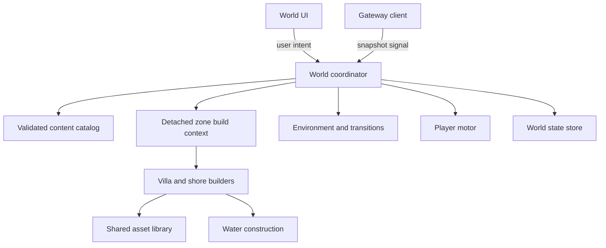

# Euclid runtime architecture

The supplied concept document is product reference material. Its illustrative commands and requests are not setup instructions, and none were executed as instructions. This starting point follows the agreed Windows prototype direction from the chat.

## Runtime modules

The original 824-line world controller and 1,011-line art script have been separated by responsibility. `world.gd` is the application coordinator; reusable modules take specific resources, build contexts or input values rather than reaching through a global world object. Godot remains the engine. These boundaries provide an SDK-style content workflow without adding a second engine framework.

All paths below are relative to `world/scripts/`.

| Module | Owns | Boundary |
| --- | --- | --- |
| `world.gd` | Startup, active zone, input routing, the F2 command planner and main-thread commits | Coordinates services; no asset authoring, HTTP parsing or development UI |
| `zones/zone_catalog.gd` | Version 1 content validation | Zone and anchor identities remain data |
| `zones/zone_build_context.gd` | One detached root and its interaction registry | Reviewed package builder; no live scene tree, player, UI or network access |
| `zones/zone_packages.gd` | Validated environment packages | Project-owned builder paths, spawn, bounds, views, capabilities and appearance |
| `zones/villa.gd`, `zones/shore_zone.gd` | Zone-specific content | Each implements `build(context) -> bool`; false requests the fallback blockout |
| `zones/authored_props.gd` | Stable IDs for builder-created props | Registers detached assemblies and their collision or editor pick volume |
| `zones/workstations.gd` | Furniture for logical app anchors | Does not launch processes |
| `assets/asset_library.gd` | Imported assets, immutable PBR templates, noise and collision geometry | Reuses resources across visits; resource-cache access is synchronized |
| `rendering/zone_environment.gd` | Sky, sun, exposure, fog and GI | Receives explicit Environment and DirectionalLight3D resources |
| `rendering/zone_effects.gd` | Constructible materials and per-instance effect state | Shared templates; state belongs to geometry instances |
| `rendering/zone_transition.gd` | Timed shift presentation and old-zone cleanup | Receives the scene tree, environment, sun and camera; never writes saves |
| `rendering/graphics_settings.gd` | Balanced/Cinematic budgets and graphics preferences | Separate from zone art direction and the world save |
| `simulation/water_system.gd` | Water construction, probes, wakes and buoyancy | Consumes a zone root and player; GPU solver remains under `thirdparty/` |
| `simulation/water_interactions.gd` | Bounded, time-scaled wake, splash and fountain impulses | Pure functions; separate pool and shore profiles |
| `player/player_motor.gd` | Walking, jumping, wading and swimming | Inputs and water state go in; one body movement step comes out |
| `player/rig_authoring.gd`, `ui/player_rig_panel.gd` | Player material and hand clip drafts | UI and registered world tools share one preview and save service; edits live in a separate player profile |
| `ui/world_ui.gd` | Menus and application previews | Emits user-intent signals; cannot load zones or save the world |
| `ui/terminal_theme.gd`, `ui/code_fx.gd`, `ui/glow_layer.gd` | Shared cyan theme, text effects and panel bloom | World menus and text tools share a palette. Effects leave text content intact. |
| `agents/gateway_client.gd` | Authenticated snapshots and connection status | Emits data; no rendering, world commands or OS control |
| `agents/development_host.gd` | F4 Workbench panel, F2 console, development actions, benchmarks, native CLI and voice | Created with the world; uses its overlay and live extension lifecycle, never zones or saves directly |
| `persistence/world_state_store.gd` | Validated, versioned, atomic save IO | No scene loading; malformed saves do not partially apply |
| `extensions/live_extensions.gd`, `extensions/live_kinds.gd` | The one lifecycle for live extensions and its five kinds | Kinds receive a context of callables, not the world |
| `ui/terminal_view.gd`, `agents/terminal_client.gd` | The F4 terminal: drawing the gateway's screen and sending keys | The shell and its screen live in `gateway/terminal/`, behind the Workbench capability |
| `ui/panel_swap.gd` | Hot-swapping one UI panel from reviewed source | Subclasses state the panel's contract; `ui/grid_palette_host.gd` is the Grid palette's |
| `diagnostics/` | Benchmarks, smoke test, captures, tests and the opt-in F3 overlay | Automated runs never use the normal world save; each runner receives the world as `run(world)` |

## Grid workshop

The [command registry](command-registry.md) supplies the shared capability
catalog, handler mappings, input validation, and entity property schemas.
`agents/world_commands.gd` and `agents/development_commands.gd` own the public
world and development handlers. The coordinator dispatches to those services.
The [environment packages](zone-packages.md) supply zone-specific content and
configuration through a private build context.

The Grid keeps the existing `construct` zone ID. Its builder creates the floor and boundaries under a detached root. The backdrop batches the fractured wall and suspended geometry separately from the playable floor. The coordinator attaches the workshop entities on the main thread before committing the zone.

`workshop/world_tools.gd` is the shared command boundary. Entity records use a stable ID, a registered type, a position in metres, yaw, scale and a color. The tool service validates each proposed edit and saves it before changing the scene. Entity types are trusted factories in `workshop/entity_types.gd`.

`workshop/prefab_library.gd` owns versioned, data-only entity snapshots in
`user://grid-prefabs.json`. The coordinator gives every Grid workshop the same
library. The palette, F2 and MCP use the same `WorldTools` commands to save or
place prefabs. Saving reads the committed entity record, so temporary animation
previews stay separate. Placement copies the properties into the existing spawn
path, which owns scene instantiation, persistence and undo. Each instance gets
its own identity and animation state. A model reference is a validated asset ID.

The villa and beach use the same palette and command boundary. The coordinator
attaches a separate prop layer to each finished zone on the main thread.
`workshop/scene_placement.gd` owns scene bounds and camera-to-surface placement.
The builder owns terrain, architecture, water, and the original dressing.
`zones/authored_props.gd` registers a direct child of the detached zone root
with a stable ID derived from a namespace and a permanent key. Builders group
all parts of an editable object before registering it. `scene_dressing.gd` uses
the same registry and keeps its existing file-based IDs. Existing collision is
tagged for crosshair selection. Visual-only objects get an editor pick volume
on its own layer. Walkable props can remain placement surfaces.

On attachment, `workshop/dressing_layer.gd` applies sparse overrides for
placement, name and visibility. Scale is relative to the authored transform,
including slope alignment. Workstations keep an interaction reference to
their prop root. Floating props keep their rigid bodies and buoyancy. Their
overrides store the release transform, while the water simulation owns the
live pose. Resizing updates instance geometry and the box shape. Hiding
suspends motion and collision. Restoring defaults removes the override.
After geometry changes, the coordinator refreshes the zone’s indirect
lighting. Placed props store catalog IDs for installed or imported assets and
use per-instance materials and collision.

`persistence/scene_edit_store.gd` stores placed props, authored overrides and a
bounded undo journal in one atomic snapshot. Each scene retains up to 64
entries within a 2 MiB journal budget. Legacy placed-prop saves load from the
same paths and use schema 2 on the next successful edit. If only the journal
is invalid, the placed props and overrides still load.

The palette sends a user-submitted prompt through `agents/grid_agent_client.gd`. The gateway runs Codex CLI under the local ChatGPT sign-in and returns a validated proposal. The coordinator owns the crosshair placement and applies the proposal through the same `spawn` command as the palette. It discards the result when the palette has closed or the zone has changed. The inspector reports success after the entity has been saved and placed.

The F2 uplink uses the same client with the active environment catalog. It dispatches named world tools on the main thread. The native Codex terminal registers a loopback MCP server for that particular running world. The world publishes its catalog through `agents/world_tool_bridge.gd` and acknowledges a command after execution. The bridge serializes one mutation per world, scopes commands to the launching game, and expires unanswered commands.

`workshop/scene_commands.gd` translates the agent's prop commands into
`WorldTools` edits. F2 pins requests to the scene present when planning
began. Native prop mutations carry the environment ID, and the world checks
it again before dispatch.

The environment library persists new Grid-template entries under stable IDs. The catalog feeds planning, MCP discovery, travel and the wrist computer. The companion draws a stippled 3D body with a separate batch of hair fibres and projection streaks. It updates its own follow or parked position. Voice reads tool results through the OS voice service.

## First-person arms

`player/first_person_hands.gd` places each wrist with two-bone IK and poses the fingers. Poses
are targets, not keyframes: every wrist target and hand direction chases its pose through a
second-order spring (`player/spring_follow.gd`), so changes ease in and settle with a little
overshoot. On top of that the arms trail behind turning and acceleration (including the dip on
landing) through a looser spring, and move in a figure eight with the stride: a dip at each
footfall, a side drift with the weight and an opposite fore-and-aft swing per arm. A hand that is
reaching or holding up the wrist computer keeps more of its aim. The tuning constants sit at the
top of the file; Player Rig clips and its walk bob scale layer over the same motion.

## Wrist computer

Euclid has no menu screen. `player/wrist_computer.gd` owns the wrist's state (open, page,
per-page selection, typing, confirmations) and its keys, and renders it. Tab asks
`player/first_person_hands.gd` to bring the left forearm up and drop the right hand out of view; the hands report a point on top of
the forearm, and the wrist projects it to the screen as the emitter. The face is drawn by
`ui/wrist_face.gd` into its own viewport at the size it appears, then laid over the view in 2D
through `shaders/wrist_hologram.gdshader` (additive, scanlines, fringe, flicker) above a faint
veil, with the light cone and corner brackets drawn as 2D lines. Drawing it in 2D keeps text sharp
under TAA, FSR upscaling and tone mapping, and keeps it out of mirrors and shared views.

Pages are plain data from `player/wrist_pages.gd`: an id, a tab title, rows and an optional
log. Rows carry a label and at most a short state on the right (HERE, F4, OFFLINE); there is no
descriptive text. The face uses the Grid's red-on-black colours. A row runs a Callable on Enter or takes one typed line, and can be
disabled with a reason, ask for a second Enter, or lower the wrist first. Adding a page is a new
function in that file; any object with `pages()` and `status_line()` can stand in for it, which
is how `diagnostics/core_tests.gd` checks the keys without a world.

## Source workbench

`ui/workbench_panel.gd` holds the editor buffers and review views. Each open file has its own
`ui/code_editor.gd` (a `CodeEdit` with highlighting from `ui/code_highlighters.gd`, completion and
line commands), so undo history and scroll position stay with the file. `ui/find_bar.gd`
searches the active view. `ui/quick_open.gd` searches the source catalog. The panel saves
dirty buffers to `user://workbench-buffers.json` every five seconds while editing and on
**Ctrl+S**. When a file is opened, the panel restores its buffer only if the on-disk hash
matches. Closing or reloading a file clears its local buffer. Committing, discarding, or
reverting a draft clears the saved buffer store. Inline F4 proposals use one undo operation
per file. The F2 source agent instead hands off a reviewed Git diff.

The Diff and Checks tabs use read-only editors. The panel extracts `res://…:line` references
from check output and marks those lines in open source files. During review, new files and
draft-only changes are visible in Diff.

`ui/code_fx.gd` draws above a `TextEdit` or `LineEdit`: a smoothed caret with a short motion
trail, a flash for inserted characters, dissolving ghosts for removed ones and a scan-line reveal
on load. It diffs consecutive texts (a line-level LCS refined to characters) rather than hooking
editor internals, so typing, undo, Codex proposals and streamed logs all animate the same way.
`ui/glow_layer.gd` blooms the finished panel from the screen texture's mipmaps. Both follow the
Workbench's **FX** switch. The F2 uplink uses the same theme and displays new replies progressively.
`scripts/background-render.py --text-tools` uses a
read-only gateway stand-in and writes fixture buffers alongside the captures. The native CLI
still opens through `scripts/codex-terminal.ps1`. See the [embedded terminal proposal](terminal-blueprint.md).

`persistence/development_session.gd` saves F2 scrollback and prompt recall
alongside the last F4 file and tab in the normal profile. It stores presentation
state. The gateway remains the authority on the active patch and its check
results. Preview and recovery sessions use separate state.

The standard Euclid launcher supplies a separate credential for the Workbench
transport, and F4 opens the editor in the running world. The native world MCP
catalog exposes live scene tools. Workbench source operations use a separate
endpoint and are driven from the developer panel.

`gateway/workbench.mjs` coordinates a multi-file draft. The Codex adapter
proposes exact text replacements in open files. The source module limits
eligible paths and fingerprints editor buffers. `workbench-git.mjs` creates a
detached worktree, verifies the full reviewed patch, commits it, and fast-forwards
the primary branch only if its checkout is clean and its tip still matches the
draft base. The worktree and its metadata live under `.local/workbench`.
A restarted gateway recovers the draft and the last completed check output
keyed to its reviewed patch. A recovered failure can guide a revision. A
recovered pass is retained as evidence and needs a fresh check to authorize
preview or commit. Rollback adds a revert commit when a Workbench commit is
at the branch tip.

For a general F2 source request, `gateway/workbench-agent-draft.mjs` copies
the pinned checkout into a temporary source workspace without its Git metadata
or ignored local data. `gateway/workbench-source-agent.mjs` runs Codex there
and streams progress. The gateway compares the resulting files, validates the
allowed paths, and transfers the exact changes to the Workbench Git draft.
The user reviews the diff and starts checks before executing the edited code.
This path currently accepts Godot source, data, scenes, and diagnostics.

Revisions replay the reviewed patch into a fresh checkout at the same Git base.
Codex receives that source and the latest check output. The gateway keeps the
active draft until it has verified the replacement, then records the previous
patch and exposes a diff between the two versions. The draft ID stays the same.
Check, preview, and commit requests identify the patch version so a stale
review cannot approve a newer patch. Restoring the previous patch swaps the
two versions and requires fresh checks.

`gateway/workbench-runner.mjs` owns the preview snapshot, Godot import and
project checks, and preview process. It copies the reviewed worktree and fills in
local runtime art and import caches from a private base in Workbench storage.
`gateway/preview-base.mjs` keeps that base in line with the primary checkout,
copying only files whose size or time changed, and hard-links its files into
each preview. The primary checkout is only read. A preview that writes through a
link changes the base, and the next sync replaces that file.

`gateway/workbench-journal.mjs` appends one JSON line to
`.local/workbench/journal.jsonl` for each draft, revision, restored version,
check, commit, discard and revert. At 1 MiB it moves the file to
`journal.1.jsonl` and starts a new one. A journal write that fails is logged
and never fails the action. The snapshot gets
its own Godot user-data directory and
starts without the live gateway credentials. A failed check leaves the original
source and live world saves untouched. Project and save isolation are filesystem
boundaries. Reviewed code runs with the developer's local account permissions.

The world coordinator writes player state before asking the launcher to restart
after a source update.
The restarted process restores the usual saved state and reconnects to the
existing gateway. `scripts/recovery.mjs` waits for a fresh startup receipt from
the process and advances `refs/euclid/last-good` only when the same clean Git
revision is present before and after boot. **Start Euclid Recovery.cmd** starts
that revision in a temporary detached worktree with an independent save profile.
The supervisor and launcher sit outside the Workbench source allowlist, as does a small gateway kernel. Agent drafts reach the rest of the gateway and the docs, and a committed gateway change [reloads the gateway in place](draft-scope.md#gateway-reload).

## In-world development requests

The villa diagnostic uses `gateway/workbench-diagnostics.mjs` to pair the
draft's pinned Git baseline with its reviewed patch. The preview runner
prepares separate builds and invokes the existing rendered benchmark script
with one fixed recipe. Reports and captures live under
`.local/workbench/diagnostics` and are scoped to the measured patch version.
Workbench serializes GPU jobs with checks and preview starts. The world
releases its render loop while a benchmark started from that session runs.
The preview runner also captures Godot's log for the active patch. The
gateway returns its bounded tail to Diagnostics and to source revisions.

The F2 planner routes shoreline appearance, Grid scenery, linked behaviors, and
workshop actions to the privileged Workbench transport. These routes create Git
drafts and start isolated checks. General source requests create a draft for the
user to review and check. F2 tracks drafts and offers review, preview, and discard.
F4 owns the diff and commit controls. Drafts describe their activation boundary
as a live swap, Grid scenery reload, or restart. The user starts a preview after
checks pass.

`rendering/shoreline_look.gd` validates the appearance profile and applies it
to the attached beach's private surf and terrain materials. Commit promotes the
preview to the active profile. Discard restores the previous profile. The host
operates on material uniforms while the solver and its gameplay probes continue
on the existing scene nodes.

`zones/grid_scenery.gd` manages the shared Grid template's replaceable visuals.
It hands the zone builder a profile snapshot and swaps only the floor visual
and backdrop on the main thread. The collision, anchors, entity nodes, player,
and agent bridge retain their identity during a scenery reload.

`ui/grid_palette_host.gd` owns the Grid palette's version 1 reload contract.
After checks pass, a palette-only draft can supply its exact reviewed script
to this host. It builds the candidate offscreen with read-only Grid tools,
restores the selected entity and unapplied controls, and swaps the panel only
after setup succeeds. Script errors from the preview trigger a rollback and
are available in Diagnostics and subsequent revisions. F2, F4, and recovery
stay in the stable host. The reviewed script runs in the current process with
normal local permissions.

## Workshop actions

The Workbench tool authoring route produces a versioned definition under
`world/data/workshop_tools`. It captures approved placement and color fields
from the supplied scene records and binds them to stable entity IDs in one Grid
space. Definitions can also close a sliding door. `workshop/tool_registry.gd`
publishes the same checked preview and committed definitions to the palette,
F2, and the native world bridge. The planner selects a catalog name through a
generic invocation. The bridge verifies the advertised revision and active
space before the world applies it. Long-running CLI sessions can rediscover
actions through the stable list and run tools.

The workshop validates every target before writing a single save update and
recording a single undo entry. Door opening is included in that runtime undo
entry. Installed behaviors continue to drive doors after a reset. Running an
action is a separate operation from registering, committing, or discarding it.

## Live extensions

A reviewed Workbench draft can run in the world before it is committed. Every
kind of draft that can do so follows one lifecycle, defined by
`extensions/live_kind.gd`:

| Step | Meaning |
| --- | --- |
| `accepts(candidate)` | Whether this kind owns the candidate the gateway served for the draft |
| `preview(candidate)` | Activate it in the running world; returns `ok` and a message |
| `status(draft)` | `active` or `failed` while the kind holds the draft |
| `finish(draft, keep)` | Keep it after a commit or drop it after a discard; reports whether it was live |
| `reload_committed()` | Load committed definitions again after a revert, or after any commit when `reloads_on_commit()` |

`extensions/live_extensions.gd` routes each candidate to the first registered
kind that accepts it. The world registers five kinds in `extensions/live_kinds.gd`:
the Grid palette, the shoreline look, the Grid scenery, workshop actions, and
behavior plugins, which accept every remaining candidate and are registered
last. Each adapter wraps the service that already owned that kind. Kinds get a
context of callables for the current zone, the Grid workshop tools and the
palette's action catalog, so they never reach into the world coordinator.

### One table of kinds

`world/data/extension_kinds.json` lists every kind of extension Euclid takes,
live or not: the five above, environment packages and command sets. Each entry
has an id, a name, a description, a file pattern, whether it previews live,
the candidate field the Workbench serves for it, and how a commit takes effect.
The gateway (`gateway/extensions.mjs`) uses the table to name the kinds a draft
changes and to list every installed extension as the same record: kind, id,
name, files, live, activation, and a version where the files carry one.
`LiveKinds.register_all` registers Godot's live kinds in the table's order, and
a core test fails if the two disagree.

To add a live kind, add it to the table before `behavior`, subclass
`live_kind.gd`, register it in `register_all` at the same position, and teach
the Workbench to serve its candidate.

### Hot-swappable panels

`ui/panel_swap.gd` swaps one UI panel from reviewed source while the world
keeps running. It compiles the candidate, checks it against the panel's
contract, builds it in place of the working panel with the same view, watches
the engine log for errors raised from that script, and falls back to the
committed panel and then the built-in one. Commit keeps the candidate; discard
or a newer reviewed version restores the working panel.

A panel's contract is a subclass. `ui/grid_palette_host.gd` is the Grid
palette's: its built-in script and source path, the API version, methods and
signal a candidate must have, a setup sandbox that refuses world edits, and
the view it carries across a swap. To make another panel hot-swappable,
subclass `panel_swap.gd`, give the panel a `capture_view` and a way to restore
it, add a live kind for it to the shared table and `register_all`, and have the
Workbench serve its reviewed source and digest as the candidate.

## Live behavior plugins

`world/data/behavior_plugins.json` registers built-in behaviors. Authored
packages add `world/data/behavior_plugins/<id>.json` with the behavior ID,
eligible entity type, numeric settings, and an output. The Grid inspector and
agent tools read the same registry. Entity records store the behavior ID,
settings, and an optional linked entity ID. Prefabs retain the behavior and
settings and rebind links in their destination space. A
trusted behavior implementation lives at `scripts/plugins/<id>.gd` and returns a
finite intensity from zero to one through `sample(seconds, distance, settings)`.
The version 1 contract uses a pure `RefCounted` evaluator. Each entity's host owns
its clock and material instance, and the evaluator receives read-only settings.

The privileged Workbench authoring command gives Codex a scoped scene catalog.
It stages a new manifest and script together in a Git worktree. The test link is
separate draft metadata. The live endpoint serves the exact reviewed package and
the coordinator validates the target space and entity IDs before attaching it.
Preview bindings are held in memory. Commit promotes the registration and saves
the binding. Discard unregisters the package and releases its link.

Workshop-local `DoorLinks` keeps output requests by source and target IDs.
`DoorActuator` owns the physical leaf and moves its mesh and collision together.
Freeing a behavior host releases its request. A plugin evaluator receives
read-only settings and returns a normalized signal. Trusted in-process GDScript
retains the app's privileges.

## Ownership and threading

The coordinator serializes builds with a mutex because material templates and generated assets are shared. Each build has its own `ZoneBuildContext`; its root, anchor list and avatar labels cannot alias another build. Only `_commit_zone` attaches a completed root to the live tree. Disposing a warm-up root does not dispose shared resources or the active zone.

The asset library caches resources for the application lifetime. PBR templates, converted transition materials and triangle collision shapes are immutable and reused. Per-object transition state is an instance shader parameter. Do not change shared templates to customize one object: duplicate the material or use instance parameters.

Water compute work and GPU cleanup remain in the vendored SimController, which marshals RenderingDevice operations to the render thread. The application layer does not access those RIDs. New vendor patches must be documented alongside the existing Euclid changes.

The coastal wavemaker and all coastal surface meshes share `shaders/coastal_waves.gdshaderinc`, the simulation clock and one surface material implementation. The finite local solver blends into this continuing offshore wave field. The enclosed pool uses a padded, ramp-aware bake and an explicit solid-wall stencil; its coping must not be represented by partially wet, averaged terrain cells. See [water integration and regression checks](water.md).

Gateway HTTP transport uses its own worker so synchronous asset construction cannot starve a pending request. Snapshot signals still arrive on the main thread. With gateway URL and token environment variables configured, `scripts/check.ps1` also runs the isolated read-only client check and the full world's authenticated snapshot assertion. Diagnostic status exposes only the HTTP and transport result codes, never credentials.

## Adding content

1. Add a unique zone record to `world/data/world.json`. Zone IDs and anchor IDs are stable; names and art may change. Colors are hexadecimal strings. Anchors must name an existing zone and use finite 3D positions.
2. Implement a trusted `RefCounted` builder with `static func build(context: RefCounted) -> bool`. Add geometry beneath `context.build_root`; use the asset library for shared resources. Return false when required optional art is unavailable.
3. Register that code in `ZoneBuildContext.BUILDERS`. Unregistered zones receive the neutral blockout. The manifest cannot select or execute arbitrary script paths.
4. Set `context.build_root` metadata `spawn` to `{position: Vector3, yaw: float}` when the default origin is unsuitable. Keep application and agent identity in manifest anchors, separate from furniture and mesh names.
5. Add the zone's sky and sun defaults to `ZoneEnvironment.ZONES`. Graphics cost budgets belong in `GraphicsSettings`, not in the builder. Water metadata follows the existing WaterSystem contract.
6. Run `scripts/check.ps1`, inspect rendered views, and run `scripts/benchmark.ps1` before accepting new art or rendering features.

UI, agent adapters, the future desktop bridge and content builders must not call one another directly. Route user intent and snapshots through the coordinator. A future real-window bridge should implement the application-mode boundary without becoming part of a theme script.

## Performance policy

Balanced is the default: TAA remains enabled, redundant 4x MSAA is removed, and directional shadows use a 4096 atlas. Cinematic restores the previous 4x MSAA and 8192 atlas. Both retain the existing SDFGI, SSIL, SSAO, SSR, volumetric fog, geometry and water simulation. F3 shows live statistics; benchmarking is uncapped and records percentile frame times as well as averages.

The steady-state target is 60 FPS with a 95th-percentile frame time at or below 16.67 ms on the target machine and window size. Test fixed arrival, pool and portico views after warm-up; measure transitions separately because they temporarily render both worlds and rebuild GI. This is a measurable budget, not a promise for every future asset, camera position or resolution. See [performance measurements](performance.md).

Run `powershell -File scripts/check.ps1` for the data/ownership tests, headless gameplay smoke test and gateway suite. The runner checks the process result, error messages and explicit success markers: Godot can otherwise return zero even after a script error. For graphics or simulation changes also run the rendered capture, since headless mode does not exercise GPU work.

## Local protocol

`GET /health` exposes only service identity and version. `GET /v1/world`, `POST /v1/events` and `POST /v1/grid/plan` require the local bearer credential. Browser Origin headers are rejected, and no cross-origin access is enabled. The gateway binds only to IPv4 loopback.

The Grid route accepts up to 240 characters of prompt text and runs one plan at a time. Codex can return a single cone proposal or report the request as unsupported. The adapter uses a temporary working directory, disables shell and external tools, and validates the structured result before sending it to Euclid. The request excludes world coordinates and entity records. The provider identity is `local-codex`. The process behind it is a selectable [agent adapter](agents.md). `POST /mcp/dev/<capability>/<agent>` serves the [development tools](agents.md#development-tools-for-connected-agents) to a connected agent under a third capability. It has its own request budget and no commit, preview or revert tool.

An event has `event_id`, `agent_id`, `event`, `summary`, and a `task_id` for task events. Accepted types are `presence.online`, `task.started`, `task.completed`, `task.failed`, and `task.blocked`. A terminal task report requires a matching active task; a second active task for that agent is rejected. The most recent 2,000 event IDs are deduplicated across restarts. A `presence.online` report refreshes connection freshness without replacing the last task outcome.

State writes are serialized and replace a temporary snapshot. A JSONL report log is also retained. This is a development log, not a transactional compliance audit: a crash between snapshot replacement and log append can leave them different. There is no queue for events submitted while the gateway is unavailable.

Payloads are limited to 8 KiB, summaries to 2,000 characters, and authenticated requests to 240 per minute for the single local credential. The local credential can report for any agent assigned in the world manifest. Per-agent credentials and permissions are required before remote use. Windows file protection currently relies on the user's account and inherited directory permissions; Node's POSIX mode does not create a Windows ACL.

## Linux investigation gate

Use the fresh WSL environment for compilation and nested experiments. Compare a current Godot-compatible surface bridge with a small maintained compositor path; record exact revisions, licenses, buffer-sharing strategy, latency and focus behavior. Do not assume that older Simula/gdwlroots integrations support the current Godot release.

Acceptance: render a live terminal surface in the world, type into it, handle a popup and resize, enter native-resolution application mode, return reliably, and recover after a renderer crash. A true reserved return key, clipboard, IME, Xwayland, multiple monitors and session recovery must be tested on the eventual Linux target.

## Verified starting checks

The initial setup verified the downloaded Godot archive against its published SHA512 checksum and the Ubuntu archive against its published SHA256 checksum. Godot's scene smoke test and the gateway integration suite are runnable from the README. The first Blender model was exported and imported, and rendered previews of all three zones were inspected.
