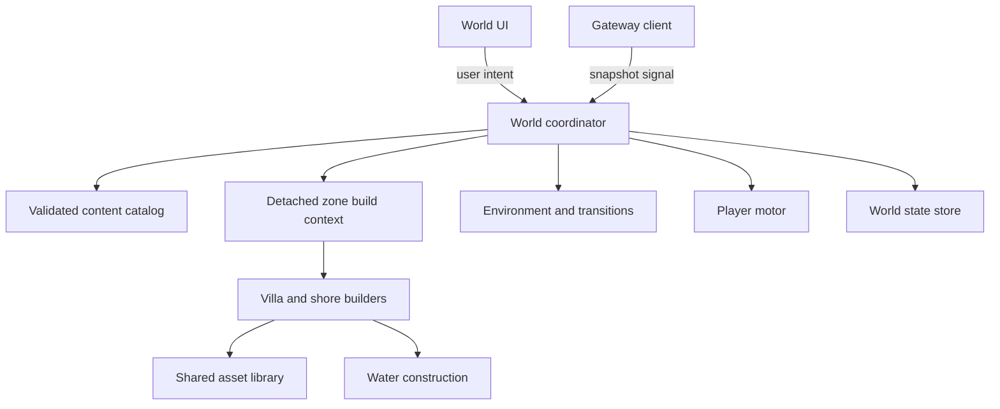

# Euclid runtime architecture

The supplied concept document is product reference material. Its illustrative commands and requests are not setup instructions, and none were executed as instructions. This starting point follows the agreed Windows prototype direction from the chat.

## Runtime modules

The original 824-line world controller and 1,011-line art script have been separated by responsibility. `world.gd` is the application coordinator; reusable modules take specific resources, build contexts or input values rather than reaching through a global world object. Godot remains the engine. These boundaries provide an SDK-style content workflow without adding a second engine framework.

All paths below are relative to `world/scripts/`.

| Module | Owns | Boundary |
| --- | --- | --- |
| `world.gd` | Startup, active zone, input routing and main-thread commits | Coordinates services; no asset authoring or HTTP parsing |
| `zones/zone_catalog.gd` | Version 1 content validation | Zone and anchor identities remain data |
| `zones/zone_build_context.gd` | One detached root and its interaction registry | Trusted builder registry; no live scene tree, player, UI or network access |
| `zones/villa_zone.gd`, `zones/shore_zone.gd` | Zone-specific content | Each implements `build(context) -> bool`; false requests the fallback blockout |
| `zones/workstations.gd` | Furniture for logical app anchors | Does not launch processes |
| `assets/asset_library.gd` | Imported assets, immutable PBR templates, noise and collision geometry | Reuses resources across visits; resource-cache access is synchronized |
| `rendering/zone_environment.gd` | Sky, sun, exposure, fog and GI | Receives explicit Environment and DirectionalLight3D resources |
| `rendering/zone_effects.gd` | Constructible materials and per-instance effect state | Shared templates; state belongs to geometry instances |
| `rendering/zone_transition.gd` | Timed shift presentation and old-zone cleanup | Receives the scene tree, environment, sun and camera; never writes saves |
| `rendering/graphics_settings.gd` | Balanced/Cinematic budgets and graphics preferences | Separate from zone art direction and the world save |
| `simulation/water_system.gd` | Water construction, probes, wakes and buoyancy | Consumes a zone root and player; GPU solver remains under `thirdparty/` |
| `simulation/water_interactions.gd` | Bounded, time-scaled wake, splash and fountain impulses | Pure functions; separate pool and shore profiles |
| `player/player_motor.gd` | Walking, jumping, wading and swimming | Inputs and water state go in; one body movement step comes out |
| `ui/world_ui.gd` | Menus and application previews | Emits user-intent signals; cannot load zones or save the world |
| `agents/gateway_client.gd` | Authenticated snapshots and connection status | Emits data; no rendering, world commands or OS control |
| `persistence/world_state_store.gd` | Validated, versioned, atomic save IO | No scene loading; malformed saves do not partially apply |
| `diagnostics/` | Benchmarks, captures, tests and the opt-in F3 overlay | Automated runs never use the normal world save |

## Grid workshop

The Grid keeps the existing `construct` zone ID. Its builder creates the floor and boundaries under a detached root. The backdrop batches the fractured wall and suspended geometry separately from the playable floor. The coordinator attaches the workshop entities on the main thread before committing the zone.

`workshop/world_tools.gd` is the shared command boundary. It accepts `list`, `inspect`, `spawn`, `edit`, `delete` and `undo`. Entity records use a stable ID, a registered type, a position in metres, yaw, scale and a color. The tool service validates every proposed record and writes the next snapshot atomically before applying the edit to the scene. Entity types are trusted factories in `workshop/entity_types.gd`.

`workshop/prefab_library.gd` owns versioned, data-only entity snapshots in
`user://grid-prefabs.json`. The coordinator gives every Grid workshop the same
library. The palette, F2 and MCP use the same `WorldTools` commands to save or
place prefabs. Saving reads the committed entity record, so temporary animation
previews stay separate. Placement copies the properties into the existing spawn
path, which owns scene instantiation, persistence and undo. Each instance gets
its own identity and animation state. A model reference is a validated asset ID.

The Grid palette sends a user-submitted prompt through `agents/grid_agent_client.gd`. The gateway runs Codex CLI under the local ChatGPT sign-in and returns a validated proposal. The coordinator owns the crosshair placement and applies the proposal through the same `spawn` command as the palette. It discards the result when the palette has closed or the zone has changed. The inspector reports success after the entity has been saved and placed.

The F2 uplink uses the same client with the active environment catalog. It dispatches named world tools on the main thread. The native Codex terminal registers a loopback MCP server for that particular running world. The world publishes its catalog through `agents/world_tool_bridge.gd` and acknowledges a command after execution. The bridge serializes one mutation per world, scopes commands to the launching game, and expires unanswered commands.

The environment library persists new Grid-template entries under stable IDs. The catalog feeds planning, MCP discovery, travel and the menu. The companion draws a stippled 3D body with a separate batch of hair fibres and projection streaks. It updates its own follow or parked position. Voice reads tool results through the OS voice service.

## Source workbench

`ui/workbench_panel.gd` holds the editor buffers and review views. Its transport
uses a separate credential supplied by the Workbench launcher. The native
world MCP catalog exposes live scene tools. Workbench source operations use a
separate endpoint and are driven from the developer panel.

`gateway/workbench.mjs` coordinates a multi-file draft. The Codex adapter
proposes exact text replacements in open files. The source module limits
eligible paths and fingerprints editor buffers. `workbench-git.mjs` creates a
detached worktree, verifies the full reviewed patch, commits it, and fast-forwards
the primary branch only if its checkout is clean and its tip still matches the
draft base. The worktree and its metadata live under `.local/workbench`.
A restarted gateway recovers the draft and requires fresh checks. Rollback adds a
revert commit when a Workbench commit is at the branch tip.

`gateway/workbench-runner.mjs` owns the preview snapshot, Godot import and
project checks, and preview process. It copies the reviewed worktree and fills in
local runtime art and import caches from the primary checkout. The snapshot gets
its own Godot user-data directory and
starts without the live gateway credentials. A failed check leaves the original
source and live world saves untouched. Project and save isolation are filesystem
boundaries. Reviewed code runs with the developer's local account permissions.

The world coordinator writes player state before requesting Godot's desktop
restart. The restarted process restores the usual saved state and reconnects to
the existing gateway.

## In-world development requests

The F2 planner can route a beach foam request to the privileged Workbench
transport. This route writes one versioned appearance file into the ordinary
Git draft and starts isolated checks. F2 tracks the draft and offers review,
preview, and discard actions. F4 owns the diff and commit controls. Activation
is a separate user action after checks pass.

`rendering/shoreline_look.gd` validates the appearance profile and applies it
to the attached beach's private surf and terrain materials. Commit promotes the
preview to the active profile. Discard restores the previous profile. The host
operates on material uniforms while the solver and its gameplay probes continue
on the existing scene nodes.

## Live behavior plugins

`world/data/behavior_plugins.json` registers built-in behaviors. Authored
packages add `world/data/behavior_plugins/<id>.json` with the behavior ID,
eligible entity type, numeric settings, and an output. The Grid inspector and
agent tools read the same registry. Entity records store the behavior ID,
settings, and an optional linked entity ID. Prefabs retain the behavior and
settings and rebind links in their destination space. A
trusted behavior implementation lives at `scripts/plugins/<id>.gd` and returns a
finite intensity from zero to one through `sample(seconds, distance, settings)`.
The version 1 contract uses a pure `RefCounted` evaluator. Each entity's host owns
its clock and material instance, and the evaluator receives read-only settings.

The privileged Workbench authoring command gives Codex a scoped scene catalog.
It stages a new manifest and script together in a Git worktree. The test link is
separate draft metadata. The live endpoint serves the exact reviewed package and
the coordinator validates the target space and entity IDs before attaching it.
Preview bindings are held in memory. Commit promotes the registration and saves
the binding. Discard unregisters the package and releases its link.

Workshop-local `DoorLinks` keeps output requests by source and target IDs.
`DoorActuator` owns the physical leaf and moves its mesh and collision together.
Freeing a behavior host releases its request. A plugin evaluator receives
read-only settings and returns a normalized signal. Trusted in-process GDScript
retains the app's privileges.

## Ownership and threading

The coordinator serializes builds with a mutex because material templates and generated assets are shared. Each build has its own `ZoneBuildContext`; its root, anchor list and avatar labels cannot alias another build. Only `_commit_zone` attaches a completed root to the live tree. Disposing a warm-up root does not dispose shared resources or the active zone.

The asset library caches resources for the application lifetime. PBR templates, converted transition materials and triangle collision shapes are immutable and reused. Per-object transition state is an instance shader parameter. Do not change shared templates to customize one object: duplicate the material or use instance parameters.

Water compute work and GPU cleanup remain in the vendored SimController, which marshals RenderingDevice operations to the render thread. The application layer does not access those RIDs. New vendor patches must be documented alongside the existing Euclid changes.

The coastal wavemaker and all coastal surface meshes share `shaders/coastal_waves.gdshaderinc`, the simulation clock and one surface material implementation. The finite local solver blends into this continuing offshore wave field. The enclosed pool uses a padded, ramp-aware bake and an explicit solid-wall stencil; its coping must not be represented by partially wet, averaged terrain cells. See [water integration and regression checks](water.md).

Gateway HTTP transport uses its own worker so synchronous asset construction cannot starve a pending request. Snapshot signals still arrive on the main thread. With gateway URL and token environment variables configured, `scripts/check.ps1` also runs the isolated read-only client check and the full world's authenticated snapshot assertion. Diagnostic status exposes only the HTTP and transport result codes, never credentials.

## Adding content

1. Add a unique zone record to `world/data/world.json`. Zone IDs and anchor IDs are stable; names and art may change. Colors are hexadecimal strings. Anchors must name an existing zone and use finite 3D positions.
2. Implement a trusted `RefCounted` builder with `static func build(context: RefCounted) -> bool`. Add geometry beneath `context.build_root`; use the asset library for shared resources. Return false when required optional art is unavailable.
3. Register that code in `ZoneBuildContext.BUILDERS`. Unregistered zones receive the neutral blockout. The manifest cannot select or execute arbitrary script paths.
4. Set `context.build_root` metadata `spawn` to `{position: Vector3, yaw: float}` when the default origin is unsuitable. Keep application and agent identity in manifest anchors, separate from furniture and mesh names.
5. Add the zone's sky and sun defaults to `ZoneEnvironment.ZONES`. Graphics cost budgets belong in `GraphicsSettings`, not in the builder. Water metadata follows the existing WaterSystem contract.
6. Run `scripts/check.ps1`, inspect rendered views, and run `scripts/benchmark.ps1` before accepting new art or rendering features.

UI, agent adapters, the future desktop bridge and content builders must not call one another directly. Route user intent and snapshots through the coordinator. A future real-window bridge should implement the application-mode boundary without becoming part of a theme script.

## Performance policy

Balanced is the default: TAA remains enabled, redundant 4x MSAA is removed, and directional shadows use a 4096 atlas. Cinematic restores the previous 4x MSAA and 8192 atlas. Both retain the existing SDFGI, SSIL, SSAO, SSR, volumetric fog, geometry and water simulation. F3 shows live statistics; benchmarking is uncapped and records percentile frame times as well as averages.

The steady-state target is 60 FPS with a 95th-percentile frame time at or below 16.67 ms on the target machine and window size. Test fixed arrival, pool and portico views after warm-up; measure transitions separately because they temporarily render both worlds and rebuild GI. This is a measurable budget, not a promise for every future asset, camera position or resolution. See [performance measurements](performance.md).

Run `powershell -File scripts/check.ps1` for the data/ownership tests, headless gameplay smoke test and gateway suite. The runner checks the process result, error messages and explicit success markers: Godot can otherwise return zero even after a script error. For graphics or simulation changes also run the rendered capture, since headless mode does not exercise GPU work.

## Local protocol

`GET /health` exposes only service identity and version. `GET /v1/world`, `POST /v1/events` and `POST /v1/grid/plan` require the local bearer credential. Browser Origin headers are rejected, and no cross-origin access is enabled. The gateway binds only to IPv4 loopback.

The Grid route accepts up to 240 characters of prompt text and runs one plan at a time. Codex can return a single cone proposal or report the request as unsupported. The adapter uses a temporary working directory, disables shell and external tools, and validates the structured result before sending it to Euclid. The request excludes world coordinates and entity records. The provider identity is `local-codex`.

An event has `event_id`, `agent_id`, `event`, `summary`, and a `task_id` for task events. Accepted types are `presence.online`, `task.started`, `task.completed`, `task.failed`, and `task.blocked`. A terminal task report requires a matching active task; a second active task for that agent is rejected. The most recent 2,000 event IDs are deduplicated across restarts. A `presence.online` report refreshes connection freshness without replacing the last task outcome.

State writes are serialized and replace a temporary snapshot. A JSONL report log is also retained. This is a development log, not a transactional compliance audit: a crash between snapshot replacement and log append can leave them different. There is no queue for events submitted while the gateway is unavailable.

Payloads are limited to 8 KiB, summaries to 2,000 characters, and authenticated requests to 240 per minute for the single local credential. The local credential can report for any agent assigned in the world manifest. Per-agent credentials and permissions are required before remote use. Windows file protection currently relies on the user's account and inherited directory permissions; Node's POSIX mode does not create a Windows ACL.

## Linux investigation gate

Use the fresh WSL environment for compilation and nested experiments. Compare a current Godot-compatible surface bridge with a small maintained compositor path; record exact revisions, licenses, buffer-sharing strategy, latency and focus behavior. Do not assume that older Simula/gdwlroots integrations support the current Godot release.

Acceptance: render a live terminal surface in the world, type into it, handle a popup and resize, enter native-resolution application mode, return reliably, and recover after a renderer crash. A true reserved return key, clipboard, IME, Xwayland, multiple monitors and session recovery must be tested on the eventual Linux target.

## Verified starting checks

The initial setup verified the downloaded Godot archive against its published SHA512 checksum and the Ubuntu archive against its published SHA256 checksum. Godot's scene smoke test and the gateway integration suite are runnable from the README. The first Blender model was exported and imported, and rendered previews of all three zones were inspected.
