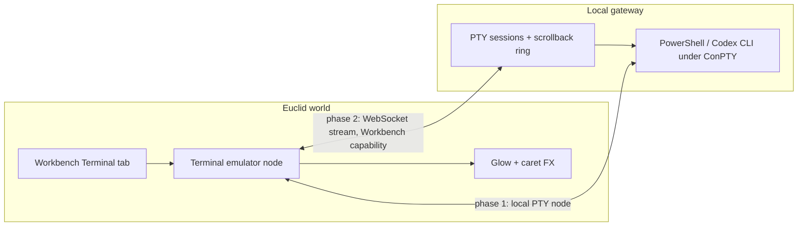

# Blueprint: a real terminal inside Euclid

**Status** · Design proposal. The current Workbench editor and F2 uplink share the
Grid-cyan theme and effects described in the [architecture notes](architecture.md#source-workbench).
F2 submits Euclid requests and **↗** opens the interactive Codex CLI in a native window.
This proposal covers embedding an interactive terminal for Codex, Git, test commands,
and PowerShell. The [development roadmap](development-roadmap.md) tracks source authoring
and session continuity alongside this work.

## What "full" means

A pseudo-terminal (PTY) makes programs believe they are talking to a real console. That is the
difference from a command runner: prompts, colours, progress bars, `Ctrl+C`, line editing and
full-screen TUIs (the Codex CLI, `less`, `htop`-style tools) all work. Two pieces are needed:

1. **A PTY host** that starts the shell under Windows ConPTY and moves bytes in and out.
2. **A terminal emulator** that interprets the VT/xterm escape sequences in the output: cursor
   moves, colours, alternate screen, scroll regions and resizes. It turns them into a grid of cells.

Euclid then draws that grid in the Workbench (and later on an in-world screen) with the same glow
and caret effects as the editor.

## Options

| | A. GodotXterm in-process | B. PTY in the gateway, emulator in Godot | C. Everything custom |
| --- | --- | --- | --- |
| PTY host | GodotXterm `PTY` node (ConPTY) inside the Godot process | `node-pty` in `gateway/`, streamed to Godot | Small ConPTY helper executable |
| Emulator | GodotXterm `Terminal` node (libtsm) | GodotXterm `Terminal` fed with `write()` | GDScript VT parser and renderer |
| Survives **Restart Euclid** | No: the shell dies with the process | Yes: the gateway keeps the session and replays scrollback | Yes |
| New dependencies | One GDExtension addon (MIT, native DLLs) | Addon plus a native npm package; the gateway currently has none | None, but a large amount of code |
| Effects control | Glow and caret; per-cell effects depend on what the node exposes | Same as A | Complete |
| Effort | Smallest | Medium | Largest. VT correctness for TUIs is the hard part |

Facts behind the table:

- GodotXterm is an MIT GDExtension terminal for Godot 4. Version 4.0.0 (2025-09-08) added Windows
  PTY support through ConPTY, which needs Windows 10 version 1903 or later. The latest Asset Library
  listing, 4.0.3, is tagged for Godot 4.3. It still needs to be tested on Euclid's Godot 4.7.2.
  https://docs.godot-xterm.nix.nz/en/latest/about/changelog.html ·
  https://godotengine.org/asset-library/asset/4301
- `node-pty` is the PTY layer behind VS Code's terminal. Its Windows backend is ConPTY.
  `@lydell/node-pty` is a fork that ships prebuilt binaries (including win32-x64) and never
  compiles at install. https://github.com/microsoft/node-pty · https://github.com/lydell/node-pty

## Recommendation

Build **A first, then move the PTY to the gateway (B)** once the terminal is worth keeping.

- **A** gets a working, correct terminal quickly. It also shows whether GodotXterm's rendering
  can carry the Grid-cyan look, or whether we will eventually want our own cell renderer.
- Restarting Euclid is part of the Workbench loop (commit → restart), so a shell that dies on
  every restart will annoy quickly. **B** fixes that without changing the panel. The `Terminal`
  node stays, and its input and output switch from the local `PTY` node to a gateway stream.
- **C** is only worth it if A shows that GodotXterm cannot give us per-cell effects or the look
  we want. Even then, keep the PTY in the gateway and replace only the renderer.

## Phases and acceptance tests

**0. Spike (half a day to a day).** Put GodotXterm 4.0.x into a scratch copy of `world/` on Godot
4.7.2.
- The extension loads. PowerShell gives a prompt, `git status` shows colours, and resizing reflows.
- The Codex CLI starts and its full-screen UI draws correctly, including the alternate screen.
- Find out what the `Terminal` node exposes: cursor cell, cell size, cell contents, theme colours.
  That decides how much of `code_fx.gd` can carry over.
- `scripts/benchmark.ps1` with the terminal open over the villa still meets 60 FPS and a 16.67 ms
  p95 frame time.

**1. Terminal tab (two to four days).** Add a **Terminal** tab beside Source / Diff / Checks.
- Toggle it with Ctrl+\`. Sessions start in the repository root. **New session** offers
  PowerShell or Codex.
- Grid-cyan theme, glow layer, glowing caret, 10k-line scrollback, Ctrl+Shift+C/V copy and paste,
  and Ctrl+C sent through to the program.
- **↗** in F2 opens Codex in this tab instead of a separate window.

**2. Gateway sessions (three to five days).** Host PTYs in `gateway/terminal.mjs` and stream over
an authenticated loopback WebSocket.
- **Restart Euclid** reattaches to the same shell, with recent output replayed from a ring buffer.
- Sessions end when the gateway exits, and one client writes at a time.
- Gateway tests cover authorisation, resize, exit codes and the size of the replay buffer.

**3. Integration (two to four days).**
- **Run checks** can stream into a terminal session.
- `res://…:line` locations in terminal output open in the editor.
- The Grid's existing **Terminal** anchor ("Not connected yet") shows a live session on a 3D
  screen through a SubViewport.

## Security boundaries

- A shell has the user's full account permissions, the same trust level as Workbench plugins
  today. The proposed terminal would be available from Workbench, behind the Workbench capability.
- The gateway listens on loopback only. The terminal endpoint uses its own capability, separate
  from the world MCP and F2 planner routes.
- The F2 agent and MCP tools cannot type into a terminal or read its output. A user may paste
  a selection into F2 explicitly, and that text is treated as data, not instructions.
- Child shells do not inherit `EUCLID_WORKBENCH_TOKEN`. Only the Codex profile gets the gateway
  variables it needs, as `scripts/codex-terminal.ps1` does now.
- Scrollback stays in memory or the ignored `.local/`, and never goes into Git.
- Recovery (`Start Euclid Recovery.cmd`) must not depend on the terminal.

## Open questions

1. Is adding the first npm dependency to the gateway acceptable in phase 2? The alternative is
   a small ConPTY helper executable built and pinned like Godot itself.
2. Should the per-character appear and disappear effects apply to terminal output? Large output
   bursts (builds, logs) may need a lighter "line arrives" effect so the screen stays readable.
3. Should more than one Euclid window (for example a preview build) be able to attach to the
   same session?
